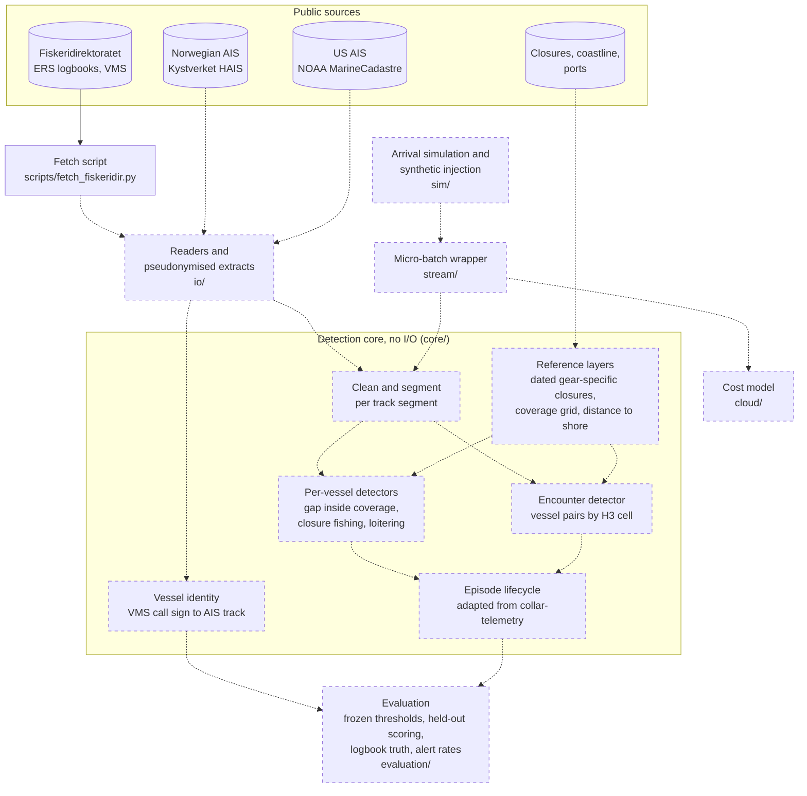

# Vessel-behaviour anomaly detection

Can a small, reproducible pipeline flag vessel behaviour worth a fisheries
analyst's attention, and how often is it right? The detectors cover fishing
inside a closure that bans the gear in use, unexplained AIS gaps, encounters
at sea and loitering, all run on public AIS tracks.

**Status:** early development. Nothing here is a result yet.

## Approach

- Every detector runs per track segment, not per MMSI, because MMSIs are
  shared and sometimes invalid.
- Closures are dated and gear-specific. Presence in a protected area is not
  treated as a signal.
- A coverage mask records where the receivers cannot see, and gaps are only
  reported inside it.
- Thresholds are tuned on one block of data, frozen, and scored once on a
  held-out block.

## How it works

The diagram shows the architecture as it stands and is updated as parts
are built. Solid boxes and arrows exist; dashed ones are planned. The
study region (Norway or the US Northeast) is still being chosen, so both
sources are shown.



- **Clean and segment:** removes invalid positions and MMSIs, duplicates
  and land fixes, then splits each vessel's track at long gaps or
  impossible speeds. Every detector works on these segments.
- **Detectors:** a gap counts only inside measured receiver coverage;
  closure fishing needs gear-like speeds inside a closure that bans that
  gear on that date; encounters and loitering follow Global Fishing
  Watch's published rules and are compared with them, not claimed as new.
- **Vessel identity:** Norwegian logbooks and VMS carry call signs, not
  MMSIs, so VMS positions are matched to AIS tracks by time and place.
  This match is what lets the detectors be scored against records kept
  independently of AIS.
- **Cost model:** estimates messages, state writes and compute for
  per-position against batched processing, rather than a deployed stack.

## Setup

Requires [uv](https://docs.astral.sh/uv/) 0.13.5 or later.

```sh
make install
source venv/bin/activate
make test lint format-check
```

`make help` lists every target.

## Licence

Code: MIT. Each dataset carries its own source and licence, recorded
alongside it.
