# Vessel-behaviour anomaly detection

[](https://github.com/benmacp123/vessel-anomaly/actions/workflows/main.yml)

Can a small, reproducible pipeline flag vessel behaviour worth a fisheries
analyst's attention, and how often is it right? The detectors cover fishing
inside a closure that bans the gear in use, unexplained AIS gaps, encounters
at sea and loitering, all run on public AIS tracks.

**Status:** detectors built and scored once on a held-out block (US
Northeast, 2024); see [Results](#results). A cost note is next.

## Approach

- Detectors run per track segment, not per MMSI, because MMSIs are shared
  and sometimes invalid. Gaps are the exception: a segment ends after 24
  hours of silence, so gaps are measured across a vessel's segments unless
  a second transmitter was heard on its ID in the day before.
- Closures are dated and gear-specific. Presence in a protected area is not
  treated as a signal.
- A coverage mask records where the receivers cannot see, and gaps are only
  reported inside it.
- Thresholds are tuned on one block of data, frozen, and scored once on a
  held-out block.

## How it works

The diagram shows the architecture as it stands and is updated as parts
are built. Solid boxes and arrows exist; dashed ones are planned. The
study region is the US Northeast (Gulf of Maine and Georges Bank) in 2024;
Norwegian data, with logbooks kept independently of AIS, is a
qualitative cross-check.

```mermaid
flowchart TB
    subgraph sources ["Public sources"]
        hais[("Norwegian AIS<br>Kystverket HAIS")]
        noaa[("US AIS<br>NOAA MarineCadastre")]
        fdir[("Fiskeridirektoratet<br>ERS logbooks, VMS")]
        refs[("Closures, coastline,<br>ports")]
    end

    fetch["Fetch scripts<br>scripts/fetch_us.py,<br>scripts/fetch_fiskeridir.py"]
    build["Extract builder<br>scripts/build_us_extract.py"]
    extract[("Committed US extract<br>data/extract/us/<br>tuning and held-out blocks,<br>reception grid")]
    io["Readers, fetch helpers<br>and extract schema<br>io/"]
    refbuild["Reference builder<br>scripts/build_us_reference.py"]
    refdata[("Committed reference layers<br>data/reference/us/<br>land, dated closures,<br>anchorages")]
    report["Cleaning report<br>scripts/report_cleaning.py<br>results/cleaning/"]
    covbuild["Coverage builder<br>scripts/build_us_coverage.py<br>results/coverage/"]
    closrep["Closure report<br>scripts/report_closures.py<br>results/closures/"]
    distbuild["Anchorage builder<br>scripts/build_us_distance.py<br>results/distance/"]
    detrep["Detector report<br>scripts/report_detectors.py<br>results/detectors/"]
    share["Encounter share, owner only<br>scripts/measure_encounter_share.py<br>results/encounters/"]

    subgraph core ["Detection core, no I/O (core/)"]
        clean["Clean and segment<br>cleaning.py, segment.py<br>GFW-style multi-track segments,<br>resumable"]
        coverage["Coverage grid<br>coverage.py<br>covered cells per AIS class,<br>distance to edge"]
        geofence["Dated geofences<br>geofence.py<br>closures, exemptions and<br>suspensions by local day"]
        layers["Distance to shore and port<br>distance.py<br>signed shore distance,<br>anchorages from stationary vessels"]
        identity["Vessel identity<br>VMS call sign to AIS track"]
        vessel["Per-vessel detectors<br>gaps.py, closure_fishing.py,<br>loitering.py, events.py<br>gap inside coverage, GFW event<br>and loitering rules"]
        encounter["Encounter detector<br>encounters.py<br>GFW 10-minute resampling,<br>pairs within 500 m, 4 h merge"]
        lifecycle["Episode lifecycle<br>lifecycle.py<br>adapted from collar-telemetry"]
    end

    sim["Arrival simulation<br>sim/arrival.py<br>delays, duplicates"]
    inject["Planted events<br>sim/inject.py<br>gaps, moved tows, partners,<br>slowed stretches"]
    stream["Micro-batch wrapper<br>stream/micro.py<br>reorder hold, watermark,<br>per-vessel tails"]
    evaluation["Evaluation<br>evaluation/<br>matching, Wilson and Poisson<br>intervals, realism, delay"]
    frozen[("Frozen thresholds<br>config/frozen.json<br>and its SHA-256")]
    evalrep["Evaluation report<br>scripts/evaluate.py<br>results/evaluation/<br>tuning check, held-out once"]
    cost["Cost model<br>cloud/"]

    fdir --> fetch
    noaa --> fetch
    refs --> fetch
    fetch --> build
    build --> extract
    io --> build
    fetch --> refbuild
    refbuild --> refdata
    hais -.-> io
    io --> distbuild
    layers --> distbuild
    distbuild --> refdata
    refdata --> io
    io --> closrep
    geofence --> closrep
    covbuild --> closrep
    extract --> io
    io --> report
    clean --> report
    io --> covbuild
    coverage --> covbuild
    coverage --> vessel
    io -.-> identity
    clean --> vessel
    clean --> encounter
    geofence --> vessel
    layers --> vessel
    io --> detrep
    vessel --> detrep
    layers --> encounter
    encounter --> detrep
    fetch --> share
    encounter --> share
    vessel --> stream
    stream --> lifecycle
    encounter --> stream
    identity -.-> evaluation
    sim --> stream
    stream --> clean
    inject --> evaluation
    lifecycle --> evaluation
    stream --> evaluation
    vessel --> evaluation
    encounter --> evaluation
    io --> evalrep
    frozen --> evalrep
    evaluation --> evalrep
    stream -.-> cost

    classDef planned stroke-dasharray: 5 5
    class identity,cost planned
```



- **Clean and segment:** invalid MMSIs are dropped when the extract is
  built (the extract keeps only hashed IDs); cleaning then drops invalid
  positions and repeated messages and nulls invalid speeds and courses,
  as Global Fishing Watch does. The segmenter follows GFW's: a vessel can
  have several open tracks, each position joins the track whose
  dead-reckoned position it fits best, and a track closes after 24 hours
  of silence, so shared MMSIs and stray positions become separate
  segments. There is no land
  mask: the open coastline is too coarse for harbours (see
  [results/cleaning/](results/cleaning/)).
- **Coverage grid:** a cell counts as covered for an AIS class when
  moving vessels there are heard without dropouts: few of their
  position-to-position intervals exceed 10 minutes, with enough
  intervals to show it (95% Wilson upper bound of that share at most
  0.1). Cells with too little traffic to tell, and cells cut by the
  study box, are not covered. It is built from the tuning block's
  all-traffic counts only. Reception turned out to reach far offshore
  along shipping lanes, so the uncovered areas are mostly quiet water,
  plus a Class B edge on Georges Bank (see
  [results/coverage/](results/coverage/)).
- **Dated geofences:** each closure row bans named gear between two
  dates; exemption rows allow some gear back inside a closure (all year,
  for a season, or under a dated fishing permit), and suspension rows
  switch an exemption off, as the northern shrimp moratorium does for the
  Western Gulf of Maine shrimp area. Dates are local days in each row's
  time zone. AIS has no gear, so a towing vessel is assumed to use mobile
  bottom-tending gear, and towing inside an open exemption is not
  flagged. Sources, dates and limits are in
  [data/reference/us/PROVENANCE.md](data/reference/us/PROVENANCE.md);
  tuning-block counts are in [results/closures/](results/closures/).
- **Distance to shore and port:** distance to shore is signed (negative
  on land) and measured on the great circle to Natural Earth's 10m
  coastline, which is coarse in harbours but agrees with NASA's
  distance-to-coast grid (the one behind GFW's offshore rules) on more
  than 99% of positions at the 20 nm and 50 nm cuts. Ports are
  anchorages found as GFW finds them, from vessels that stay within
  0.5 km for 12 hours; four weeks of data cannot meet GFW's 20 vessels,
  so a cell needs 2 and must lie within 5 km of shore, so an offshore
  meeting spot is never taken for a port. Built from the tuning block
  only (see [results/distance/](results/distance/)).
- **Closure fishing:** positions at trawl speeds (2.5–5.5 kn) inside a
  closure that bans towed gear that day are grouped by Global Fishing
  Watch's fishing-event rules (brief exits within an hour and 2 km merge;
  events under 20 minutes or 0.5 km are dropped). Every event is
  "apparent": AIS carries no gear.
- **Gaps:** a silence over 6 hours is unexplained only when both ends lie
  in covered cells, 10 km or more from an anchorage and away from the
  vessel's own mooring, after at least 14 positions in the previous 12
  hours (Welch et al. 2022), and both end cells heard traffic on every day
  it spans. Each check uses only what was known when the gap ended.
- **Loitering:** Global Fishing Watch's rule (clock hours under 2 kn, at
  least 20 nm from shore, 8 hours; 4 hours as a sensitivity). With only
  fishing vessels in the extract it mostly finds drifting and hauling, so
  it is reported as a base rate, not as evidence of transshipment.
  Tuning-block counts for all three are in
  [results/detectors/](results/detectors/).
- **Stream:** positions arrive out of order (simulated delays and
  duplicates), are held for a reorder window behind a watermark, and the
  same detectors, encounters included, run on each vessel's recent
  positions. Incidents open while an episode is under way (a vessel dark
  for 6 hours) and resolve when it is settled. Tests check that any batch
  length gives exactly the batch output.
- **Encounters:** Global Fishing Watch's published rule (pipe-encounters):
  tracks resampled every 10 minutes within each UTC day, two vessels
  within 500 m for runs of at least an hour, runs under 4 hours apart
  merged, kept when over 2 hours, under 2 kn median speed and 10 km or
  more from an anchorage. The only change makes it symmetric: speed and
  position come from both vessels, not one. On the tuning block the
  extract shows no encounters at all: 99.5% of close pairs are boats
  together in harbour. Run on all raw traffic in the same four weeks,
  the rule finds 20 encounters involving a tuning-block fishing vessel,
  and none of them is with another tuning-block vessel (pleasure craft
  8, other fishing vessels 6, unknown type 4, tugs 2), so the extract
  cannot see them (see [results/encounters/](results/encounters/)).
- **Planted events:** there is no US truth for any detector, so recall is
  measured on events planted into real tracks with fixed seeds, each kind
  in its own copy of the block: gaps cut out of real tracks at sea inside
  coverage, with lengths drawn from real gaps (the reception grid loses
  the deleted positions too); real towing runs moved into the scored
  closures, against transits moved across them; partner vessels that keep
  a real vessel's reporting times and meet a real slow vessel offshore,
  against GFW's near misses (600 m for 2 hours, 400 m for 1.5 hours); and
  real offshore stretches slowed to loitering speed, against stretches too
  short or not slow enough. Moved and slowed copies are new vessel IDs, so
  no track jumps. A detection overlapping no planted event is a real
  alert, so precision is never reported for real data: real alerts are
  rates per 1,000 vessel-days (or fishing-vessel-hours near a closure)
  with Poisson intervals.
- **Realism check:** planted gaps are compared with real gaps in the same
  population (feature distributions, and the AUC of a small logistic
  discriminator on a fixed split). Recall on planted gaps is only as good
  as that resemblance.
- **Frozen thresholds and one-shot scoring:** every threshold, generator
  setting and band, plus the hashes of the committed inputs, is written
  from the code to `config/frozen.json` (`make freeze`); a test fails if
  the code and the file differ. The file and its SHA-256 are committed
  before the held-out block is read, and `make score` refuses to run if
  either has changed or held-out results already exist. Thresholds were
  frozen as they stood after the tuning block, with no search: the only
  US truth is our own planted events, and tuning against them would fit
  the generator, not reality.
- **Vessel identity:** Norwegian logbooks and VMS carry call signs, not
  MMSIs, so VMS positions are matched to AIS tracks by time and place. A
  test week matched 84% of call signs to a unique MMSI, but none of that
  week's towed hauls fell inside the area covered by the AIS data, so
  Norway is a cross-check rather than the scored region.
- **Committed extract:** fishing-vessel positions for four tuning and
  four held-out weeks, with MMSIs replaced by salted hashes and each block
  holding a different half of the fleet. Provenance, terms and checksums
  are in [data/extract/us/PROVENANCE.md](data/extract/us/PROVENANCE.md).
- **Cost model:** estimates messages, state writes and compute for
  per-position against batched processing, rather than a deployed stack.

## Results

Thresholds were frozen after the tuning block (`config/frozen.json`, SHA-256
`be6d0bad…`, committed before any held-out data was read) and the held-out
block (20 May–2 June and 16–29 September 2024; 542 fishing vessels, none of
them in the tuning block) was scored once, with no re-runs. Every figure
below is from [results/evaluation/](results/evaluation/); the tuning-block
figures beside it are the same run on the data the thresholds came from.

There is no ground truth for illegal behaviour in US AIS, so the results
come in two kinds that must not be mixed: recall on events planted into
real tracks, and alert rates on the real data. A real alert is "apparent"
behaviour worth a look, never a confirmed violation, and no precision is
claimed for it.

### Recall on planted events

| Detector | Held-out: found / planted (95% interval) | Tuning | Planted negatives flagged (held-out) |
|---|---|---|---|
| Gap inside coverage | 107 / 150, 71% (64–78%) | 80% | 0 / 50 shorter than 6 h |
| Fishing in a closure | 100 / 100 (96–100%) | 100% | 0 / 50 transits |
| Encounter | 24 / 24 (86–100%) | 100% | 0 / 28 near misses |
| Loitering | 25 / 25 (87–100%) | 96% | 0 / 63 too short or too fast |

- **Gaps are the only detector that misses planted events**, and mostly
  by design: a gap counts as unexplained only if both end cells heard
  other traffic on every day it spans, and in quiet water they often did
  not. Recall is 79% for Class A transceivers and 66% for Class B.
- **The other detectors' perfect scores mainly show the rules are
  implemented as written.** A towing run moved into a closure, or a
  partner held within 400 m for hours, is an easy case; the negatives
  show the rules do not fire on near misses.
- **Planted gaps are easier than real ones.** A small classifier tells
  planted gaps from real ones in the same area with an AUC of 0.71
  (0.5 would mean indistinguishable): planted gaps follow more positions
  (median about 220 against 70 in the previous 12 hours). So 71% is an
  upper estimate of recall on real gaps, especially for vessels that
  report sparsely.
- **Planted counts are uneven** because suitable host tracks ran out
  (slow vessels offshore for encounters, long offshore stretches for
  loitering); the intervals show what that costs.

### Detection delay in the stream

Replaying each planted block through the stream (positions up to 20
minutes late, a 30-minute reorder hold, hourly batches), the first
incident came a median of 0.9–1.1 hours after the rule could first be met,
and within 1.4–1.7 hours for 90% of events, for every detector. For gaps
this is the time to hear of a silence: the stream warns of any vessel dark
for 6 hours before it can tell whether the silence is explained.

### Alert rates on real data (held-out block)

Rates have 95% Poisson intervals; full tables, by distance to the coverage
edge, are in [heldout_alerts.csv](results/evaluation/heldout_alerts.csv).

| Alert | Class A | Class B |
|---|---|---|
| Unexplained gaps, per 1,000 vessel-days | 70 (51–93) | 24 (19–30) |
| Same rule without the coverage mask | 201 | 100 |
| GFW's published rule (12 h, 50 nm offshore) | 83 | 31 |
| Loitering 8 h or more, per 1,000 vessel-days | 110 | 33 |

- **The coverage mask does its job:** it removes two-thirds to three
  quarters of gap alerts, those starting in cells without proven
  reception or whose end cells heard no traffic that day.
- **Class A rates are about three times the tuning block's**, for gaps
  and loitering alike, and come from about 20 vessels. A few vessels
  dominate four weeks of data, so rates move a lot between blocks.
- **Apparent fishing in the four scored closures:** 39 events from 16
  vessels (tuning: 109 from 28). Per 1,000 fishing-vessel-hours within
  10 km: Eastern Maine 47, Great South Channel 11, Western Gulf of Maine 6,
  Stellwagen Bank 4. AIS carries no gear, so a lobster boat hauling at
  trawl speed looks the same as a trawler.
- **Encounters:** 2 on the held-out block, 0 on the tuning block. The
  extract holds only one half of the fishing fleet, so meetings with
  other vessels are invisible; encounter recall therefore comes from
  planted events only.

### Limits

- Recall is measured on planted events, which are cleaner than real ones
  (see the realism check); real recall is unknown.
- Four weeks per block, two seasons, one region, terrestrial receivers
  only.
- Vessels without AIS, and anything beyond receiver range, are outside
  every claim.
- NOAA enforcement cases were not compared: few are dated or located, few
  would fall in four weeks, and matching one to a hashed track would undo
  the pseudonymisation.

## Data

The committed US extract in [data/extract/us/](data/extract/us/) holds
fishing-vessel AIS positions (types 30, 1001 and 1002) for the Gulf of
Maine and Georges Bank, from NOAA MarineCadastre 2024. MMSIs are
replaced by salted hashes after dropping MMSIs whose country code (MID)
is outside the ship range 201–775, and each block holds a different half
of the fleet:

| Block | Days | Rows | Vessels |
| --- | --- | --- | --- |
| Tuning | 6–19 May, 2–15 September 2024 | 940,471 | 585 |
| Held out | 20 May–2 June, 16–29 September 2024 | 926,123 | 542 |

No vessel is in both blocks. Each block also carries a daily reception
grid of all-traffic counts per H3 cell and AIS class (positions,
vessels, and moving intervals with how many exceed 10 minutes), for the
coverage mask. The whole
extract is 25 MB, with no file over 1 MB. Sources, terms, column
definitions and checksums are in
[PROVENANCE.md](data/extract/us/PROVENANCE.md); counts per day are in
`counts.csv`.

## Setup

Requires [uv](https://docs.astral.sh/uv/) 0.13.5 or later.

```sh
make install
source venv/bin/activate
make test lint format-check
```

`make help` lists every target.

## Licence

Code: MIT. Each dataset carries its own source and licence, recorded
alongside it.
