# Vessel-behaviour anomaly detection

[](https://github.com/benmacp123/vessel-anomaly/actions/workflows/main.yml)

Can a small, reproducible pipeline flag vessel behaviour worth a fisheries
analyst's attention, and how often is it right? The detectors cover fishing
inside a closure that bans the gear in use, unexplained AIS gaps, encounters
at sea and loitering, all run on public AIS tracks.

**Status:** early development. Nothing here is a result yet.

## Approach

- Detectors run per track segment, not per MMSI, because MMSIs are shared
  and sometimes invalid. Gaps are the exception: a segment ends after 24
  hours of silence, so gaps are measured across a vessel's segments unless
  a second transmitter was heard on its ID in the day before.
- Closures are dated and gear-specific. Presence in a protected area is not
  treated as a signal.
- A coverage mask records where the receivers cannot see, and gaps are only
  reported inside it.
- Thresholds are tuned on one block of data, frozen, and scored once on a
  held-out block.

## How it works

The diagram shows the architecture as it stands and is updated as parts
are built. Solid boxes and arrows exist; dashed ones are planned. The
study region is the US Northeast (Gulf of Maine and Georges Bank) in 2024;
Norwegian data, with logbooks kept independently of AIS, is a
qualitative cross-check.

```mermaid
flowchart TB
    subgraph sources ["Public sources"]
        hais[("Norwegian AIS<br>Kystverket HAIS")]
        noaa[("US AIS<br>NOAA MarineCadastre")]
        fdir[("Fiskeridirektoratet<br>ERS logbooks, VMS")]
        refs[("Closures, coastline,<br>ports")]
    end

    fetch["Fetch scripts<br>scripts/fetch_us.py,<br>scripts/fetch_fiskeridir.py"]
    build["Extract builder<br>scripts/build_us_extract.py"]
    extract[("Committed US extract<br>data/extract/us/<br>tuning and held-out blocks,<br>reception grid")]
    io["Readers, fetch helpers<br>and extract schema<br>io/"]
    refbuild["Reference builder<br>scripts/build_us_reference.py"]
    refdata[("Committed reference layers<br>data/reference/us/<br>land, dated closures,<br>anchorages")]
    report["Cleaning report<br>scripts/report_cleaning.py<br>results/cleaning/"]
    covbuild["Coverage builder<br>scripts/build_us_coverage.py<br>results/coverage/"]
    closrep["Closure report<br>scripts/report_closures.py<br>results/closures/"]
    distbuild["Anchorage builder<br>scripts/build_us_distance.py<br>results/distance/"]
    detrep["Detector report<br>scripts/report_detectors.py<br>results/detectors/"]
    share["Encounter share, owner only<br>scripts/measure_encounter_share.py<br>results/encounters/"]

    subgraph core ["Detection core, no I/O (core/)"]
        clean["Clean and segment<br>cleaning.py, segment.py<br>GFW-style multi-track segments,<br>resumable"]
        coverage["Coverage grid<br>coverage.py<br>covered cells per AIS class,<br>distance to edge"]
        geofence["Dated geofences<br>geofence.py<br>closures, exemptions and<br>suspensions by local day"]
        layers["Distance to shore and port<br>distance.py<br>signed shore distance,<br>anchorages from stationary vessels"]
        identity["Vessel identity<br>VMS call sign to AIS track"]
        vessel["Per-vessel detectors<br>gaps.py, closure_fishing.py,<br>loitering.py, events.py<br>gap inside coverage, GFW event<br>and loitering rules"]
        encounter["Encounter detector<br>encounters.py<br>GFW 10-minute resampling,<br>pairs within 500 m, 4 h merge"]
        lifecycle["Episode lifecycle<br>lifecycle.py<br>adapted from collar-telemetry"]
    end

    sim["Arrival simulation<br>sim/arrival.py<br>delays, duplicates"]
    inject["Synthetic injection<br>sim/"]
    stream["Micro-batch wrapper<br>stream/micro.py<br>reorder hold, watermark,<br>per-vessel tails"]
    evaluation["Evaluation<br>frozen thresholds, held-out scoring,<br>logbook truth, alert rates<br>evaluation/"]
    cost["Cost model<br>cloud/"]

    fdir --> fetch
    noaa --> fetch
    refs --> fetch
    fetch --> build
    build --> extract
    io --> build
    fetch --> refbuild
    refbuild --> refdata
    hais -.-> io
    io --> distbuild
    layers --> distbuild
    distbuild --> refdata
    refdata --> io
    io --> closrep
    geofence --> closrep
    covbuild --> closrep
    extract --> io
    io --> report
    clean --> report
    io --> covbuild
    coverage --> covbuild
    coverage --> vessel
    io -.-> identity
    clean --> vessel
    clean --> encounter
    geofence --> vessel
    layers --> vessel
    io --> detrep
    vessel --> detrep
    layers --> encounter
    encounter --> detrep
    fetch --> share
    encounter --> share
    vessel --> stream
    stream --> lifecycle
    encounter --> stream
    identity -.-> evaluation
    sim --> stream
    stream --> clean
    inject -.-> evaluation
    lifecycle -.-> evaluation
    stream -.-> cost

    classDef planned stroke-dasharray: 5 5
    class identity,inject,evaluation,cost planned
```



- **Clean and segment:** invalid MMSIs are dropped when the extract is
  built (the extract keeps only hashed IDs); cleaning then drops invalid
  positions and repeated messages and nulls invalid speeds and courses,
  as Global Fishing Watch does. The segmenter follows GFW's: a vessel can
  have several open tracks, each position joins the track whose
  dead-reckoned position it fits best, and a track closes after 24 hours
  of silence, so shared MMSIs and stray positions become separate
  segments. There is no land
  mask: the open coastline is too coarse for harbours (see
  [results/cleaning/](results/cleaning/)).
- **Coverage grid:** a cell counts as covered for an AIS class when
  moving vessels there are heard without dropouts: few of their
  position-to-position intervals exceed 10 minutes, with enough
  intervals to show it (95% Wilson upper bound of that share at most
  0.1). Cells with too little traffic to tell, and cells cut by the
  study box, are not covered. It is built from the tuning block's
  all-traffic counts only. Reception turned out to reach far offshore
  along shipping lanes, so the uncovered areas are mostly quiet water,
  plus a Class B edge on Georges Bank (see
  [results/coverage/](results/coverage/)).
- **Dated geofences:** each closure row bans named gear between two
  dates; exemption rows allow some gear back inside a closure (all year,
  for a season, or under a dated fishing permit), and suspension rows
  switch an exemption off, as the northern shrimp moratorium does for the
  Western Gulf of Maine shrimp area. Dates are local days in each row's
  time zone. AIS has no gear, so a towing vessel is assumed to use mobile
  bottom-tending gear, and towing inside an open exemption is not
  flagged. Sources, dates and limits are in
  [data/reference/us/PROVENANCE.md](data/reference/us/PROVENANCE.md);
  tuning-block counts are in [results/closures/](results/closures/).
- **Distance to shore and port:** distance to shore is signed (negative
  on land) and measured on the great circle to Natural Earth's 10m
  coastline, which is coarse in harbours but agrees with NASA's
  distance-to-coast grid (the one behind GFW's offshore rules) on more
  than 99% of positions at the 20 nm and 50 nm cuts. Ports are
  anchorages found as GFW finds them, from vessels that stay within
  0.5 km for 12 hours; four weeks of data cannot meet GFW's 20 vessels,
  so a cell needs 2 and must lie within 5 km of shore, so an offshore
  meeting spot is never taken for a port. Built from the tuning block
  only (see [results/distance/](results/distance/)).
- **Closure fishing:** positions at trawl speeds (2.5–5.5 kn) inside a
  closure that bans towed gear that day are grouped by Global Fishing
  Watch's fishing-event rules (brief exits within an hour and 2 km merge;
  events under 20 minutes or 0.5 km are dropped). Every event is
  "apparent": AIS carries no gear.
- **Gaps:** a silence over 6 hours is unexplained only when both ends lie
  in covered cells, 10 km or more from an anchorage and away from the
  vessel's own mooring, after at least 14 positions in the previous 12
  hours (Welch et al. 2022), and both end cells heard traffic on every day
  it spans. Each check uses only what was known when the gap ended.
- **Loitering:** Global Fishing Watch's rule (clock hours under 2 kn, at
  least 20 nm from shore, 8 hours; 4 hours as a sensitivity). With only
  fishing vessels in the extract it mostly finds drifting and hauling, so
  it is reported as a base rate, not as evidence of transshipment.
  Tuning-block counts for all three are in
  [results/detectors/](results/detectors/).
- **Stream:** positions arrive out of order (simulated delays and
  duplicates), are held for a reorder window behind a watermark, and the
  same detectors, encounters included, run on each vessel's recent
  positions. Incidents open while an episode is under way (a vessel dark
  for 6 hours) and resolve when it is settled. Tests check that any batch
  length gives exactly the batch output.
- **Encounters:** Global Fishing Watch's published rule (pipe-encounters):
  tracks resampled every 10 minutes within each UTC day, two vessels
  within 500 m for runs of at least an hour, runs under 4 hours apart
  merged, kept when over 2 hours, under 2 kn median speed and 10 km or
  more from an anchorage. The only change makes it symmetric: speed and
  position come from both vessels, not one. On the tuning block the
  extract shows no encounters at all: 99.5% of close pairs are boats
  together in harbour. Run on all raw traffic in the same four weeks,
  the rule finds 20 encounters involving a tuning-block fishing vessel,
  and none of them is with another tuning-block vessel (pleasure craft
  8, other fishing vessels 6, unknown type 4, tugs 2), so the extract
  cannot see them (see [results/encounters/](results/encounters/)).
- **Vessel identity:** Norwegian logbooks and VMS carry call signs, not
  MMSIs, so VMS positions are matched to AIS tracks by time and place. A
  test week matched 84% of call signs to a unique MMSI, but none of that
  week's towed hauls fell inside the area covered by the AIS data, so
  Norway is a cross-check rather than the scored region.
- **Committed extract:** fishing-vessel positions for four tuning and
  four held-out weeks, with MMSIs replaced by salted hashes and each block
  holding a different half of the fleet. Provenance, terms and checksums
  are in [data/extract/us/PROVENANCE.md](data/extract/us/PROVENANCE.md).
- **Cost model:** estimates messages, state writes and compute for
  per-position against batched processing, rather than a deployed stack.

## Data

The committed US extract in [data/extract/us/](data/extract/us/) holds
fishing-vessel AIS positions (types 30, 1001 and 1002) for the Gulf of
Maine and Georges Bank, from NOAA MarineCadastre 2024. MMSIs are
replaced by salted hashes after dropping MMSIs whose country code (MID)
is outside the ship range 201–775, and each block holds a different half
of the fleet:

| Block | Days | Rows | Vessels |
| --- | --- | --- | --- |
| Tuning | 6–19 May, 2–15 September 2024 | 940,471 | 585 |
| Held out | 20 May–2 June, 16–29 September 2024 | 926,123 | 542 |

No vessel is in both blocks. Each block also carries a daily reception
grid of all-traffic counts per H3 cell and AIS class (positions,
vessels, and moving intervals with how many exceed 10 minutes), for the
coverage mask. The whole
extract is 25 MB, with no file over 1 MB. Sources, terms, column
definitions and checksums are in
[PROVENANCE.md](data/extract/us/PROVENANCE.md); counts per day are in
`counts.csv`.

## Setup

Requires [uv](https://docs.astral.sh/uv/) 0.13.5 or later.

```sh
make install
source venv/bin/activate
make test lint format-check
```

`make help` lists every target.

## Licence

Code: MIT. Each dataset carries its own source and licence, recorded
alongside it.
