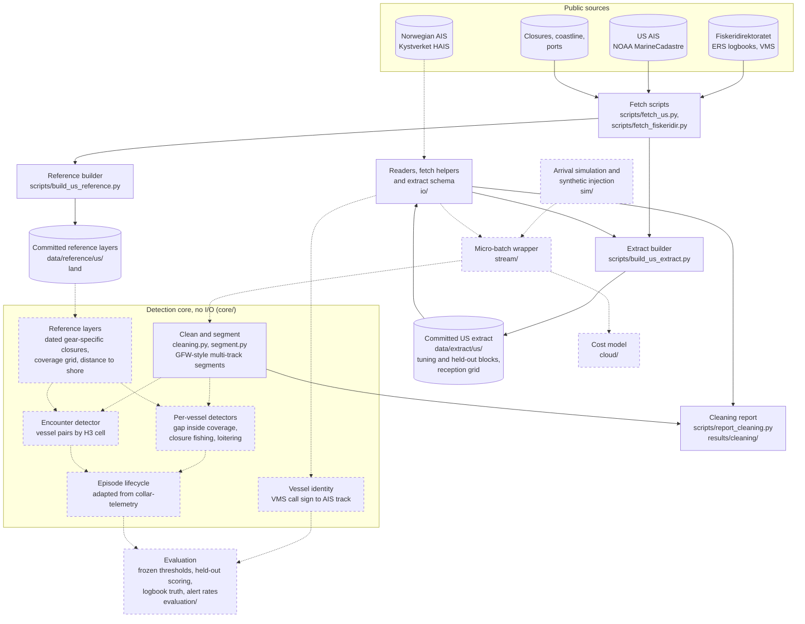

# Vessel-behaviour anomaly detection

[](https://github.com/benmacp123/vessel-anomaly/actions/workflows/main.yml)

Can a small, reproducible pipeline flag vessel behaviour worth a fisheries
analyst's attention, and how often is it right? The detectors cover fishing
inside a closure that bans the gear in use, unexplained AIS gaps, encounters
at sea and loitering, all run on public AIS tracks.

**Status:** early development. Nothing here is a result yet.

## Approach

- Every detector runs per track segment, not per MMSI, because MMSIs are
  shared and sometimes invalid.
- Closures are dated and gear-specific. Presence in a protected area is not
  treated as a signal.
- A coverage mask records where the receivers cannot see, and gaps are only
  reported inside it.
- Thresholds are tuned on one block of data, frozen, and scored once on a
  held-out block.

## How it works

The diagram shows the architecture as it stands and is updated as parts
are built. Solid boxes and arrows exist; dashed ones are planned. The
study region is the US Northeast (Gulf of Maine and Georges Bank) in 2024;
Norwegian data, with logbooks kept independently of AIS, is a
qualitative cross-check.



- **Clean and segment:** invalid MMSIs are dropped when the extract is
  built (the extract keeps only hashed IDs); cleaning then drops invalid
  positions and repeated messages and nulls invalid speeds and courses,
  as Global Fishing Watch does. The segmenter follows GFW's: a vessel can
  have several open tracks, each position joins the track whose
  dead-reckoned position it fits best, and a track closes after 24 hours
  of silence, so shared MMSIs and stray positions become separate
  segments. Every detector works on these segments. There is no land
  mask: the open coastline is too coarse for harbours (see
  [results/cleaning/](results/cleaning/)).
- **Detectors:** a gap counts only inside measured receiver coverage;
  closure fishing needs gear-like speeds inside a closure that bans that
  gear on that date; encounters and loitering follow Global Fishing
  Watch's published rules and are compared with them, not claimed as new.
- **Vessel identity:** Norwegian logbooks and VMS carry call signs, not
  MMSIs, so VMS positions are matched to AIS tracks by time and place. A
  test week matched 84% of call signs to a unique MMSI, but none of that
  week's towed hauls fell inside the area covered by the AIS data, so
  Norway is a cross-check rather than the scored region.
- **Committed extract:** fishing-vessel positions for four tuning and
  four held-out weeks, with MMSIs replaced by salted hashes and each block
  holding a different half of the fleet. Provenance, terms and checksums
  are in [data/extract/us/PROVENANCE.md](data/extract/us/PROVENANCE.md).
- **Cost model:** estimates messages, state writes and compute for
  per-position against batched processing, rather than a deployed stack.

## Data

The committed US extract in [data/extract/us/](data/extract/us/) holds
fishing-vessel AIS positions (types 30, 1001 and 1002) for the Gulf of
Maine and Georges Bank, from NOAA MarineCadastre 2024. MMSIs are
replaced by salted hashes after dropping MMSIs whose country code (MID)
is outside the ship range 201–775, and each block holds a different half
of the fleet:

| Block | Days | Rows | Vessels |
| --- | --- | --- | --- |
| Tuning | 6–19 May, 2–15 September 2024 | 940,471 | 585 |
| Held out | 20 May–2 June, 16–29 September 2024 | 926,123 | 542 |

No vessel is in both blocks. Each block also carries a daily reception
grid of all-traffic counts per H3 cell, for the coverage mask. The whole
extract is 25 MB, with no file over 1 MB. Sources, terms, column
definitions and checksums are in
[PROVENANCE.md](data/extract/us/PROVENANCE.md); counts per day are in
`counts.csv`.

## Setup

Requires [uv](https://docs.astral.sh/uv/) 0.13.5 or later.

```sh
make install
source venv/bin/activate
make test lint format-check
```

`make help` lists every target.

## Licence

Code: MIT. Each dataset carries its own source and licence, recorded
alongside it.
